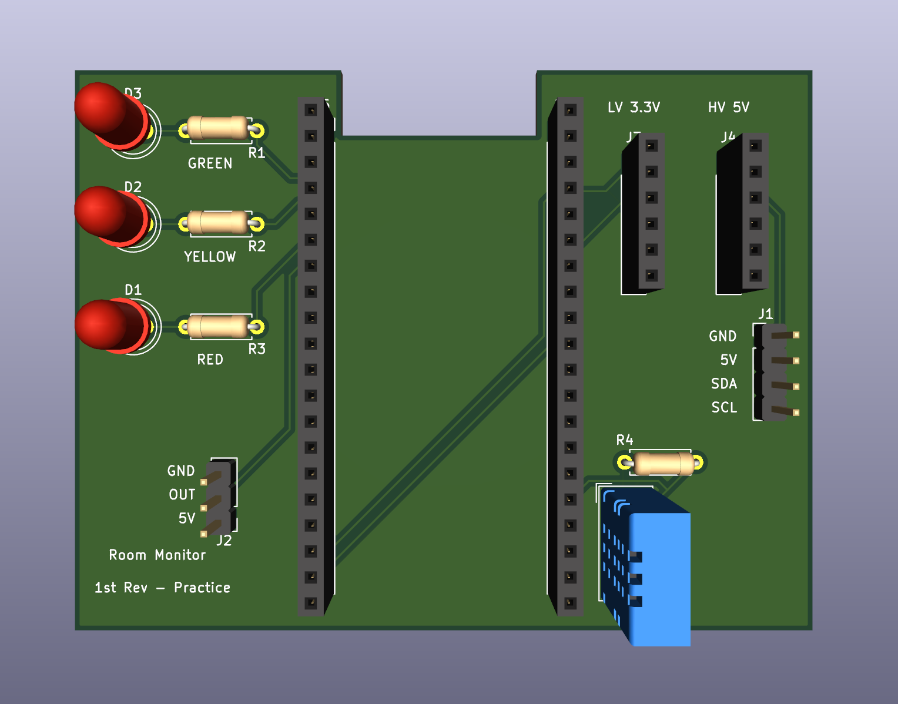
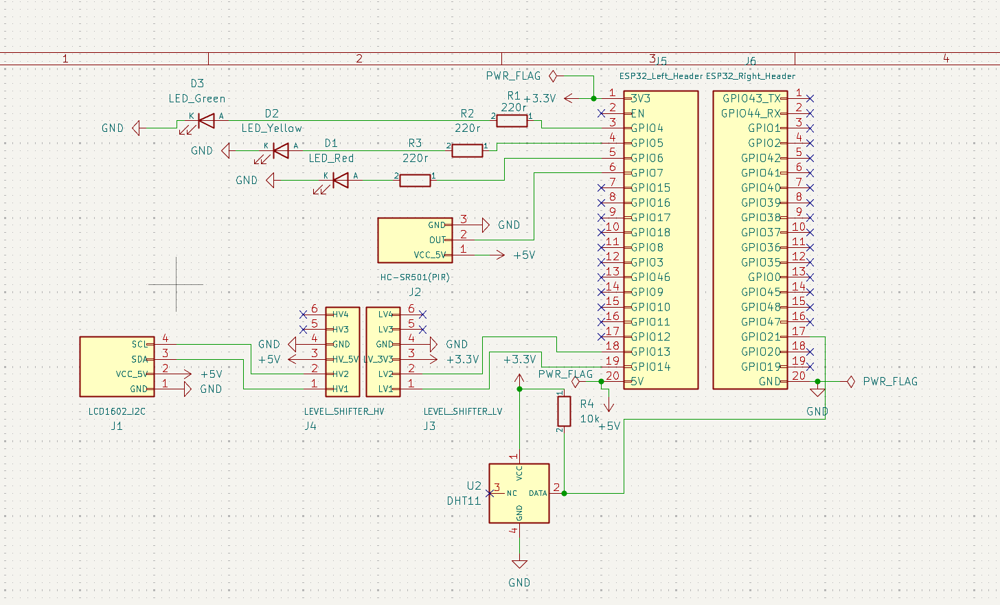
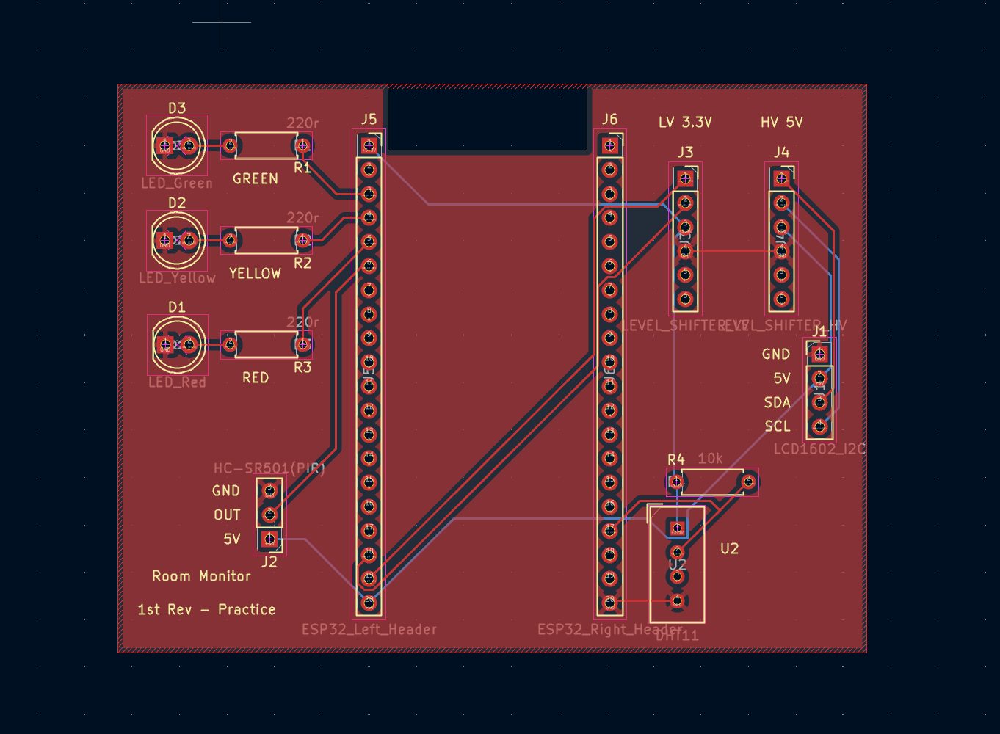
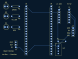
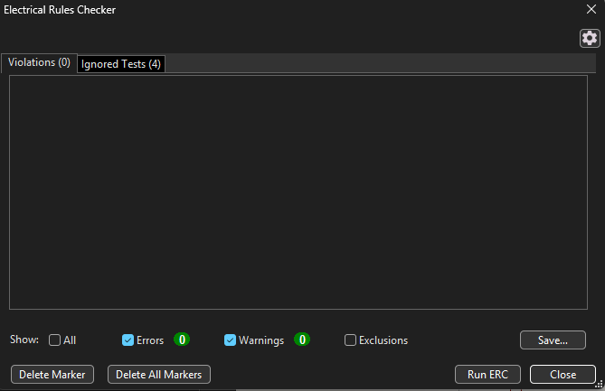
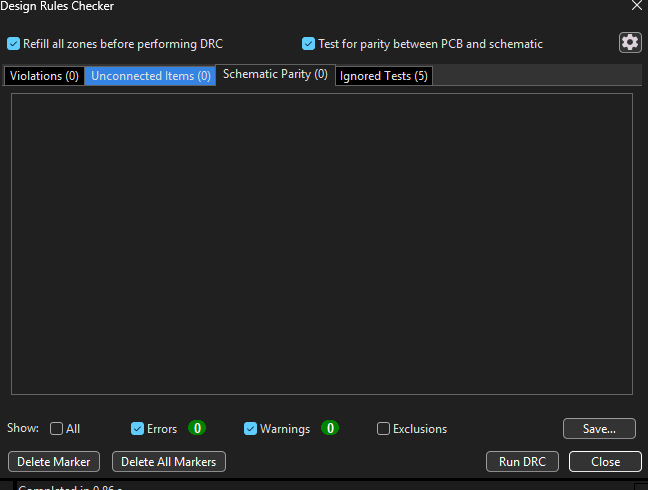

# Room Monitor — KiCad PCB Practice

I made this carrier-board layout to practice moving from a schematic to a routed PCB in KiCad. It uses the DHT11, LEDs, PIR connector, LCD connector, and I2C level-shifter interface from my room monitor.

**Status — October 16, 2026:** schematic and PCB checks pass under the saved project settings. This is an **unfabricated design exercise**. I have not ordered, assembled, powered, or physically tested this PCB. The working breadboard build and its tests are documented in the [main project README](../../../README.md).



This is a KiCad rendering, not a photograph of an assembled PCB. The ESP32-S3 and level-shifter modules are represented by their sockets. The LCD and PIR are external modules connected through J1 and J2. All three LEDs look red because they share a generic 3D model; the schematic and silkscreen identify their intended colors.

## Project files

Open [ROOM ENVIRONMENT PCB PRACTICE.kicad_pro](<ROOM ENVIRONMENT PCB PRACTICE.kicad_pro>) in **KiCad 10.0.6**, then open its schematic or PCB. Keep the following files together:

| File | Purpose |
| --- | --- |
| [Schematic](<ROOM ENVIRONMENT PCB PRACTICE.kicad_sch>) | Connections and assigned footprints |
| [PCB layout](<ROOM ENVIRONMENT PCB PRACTICE.kicad_pcb>) | Placement, routing, outline, ground zone, and silkscreen |
| [Project settings](<ROOM ENVIRONMENT PCB PRACTICE.kicad_pro>) | Saved rules and project configuration |
| [RoomMonitor.kicad_sym](RoomMonitor.kicad_sym) and [sym-lib-table](sym-lib-table) | Local symbols and their project-relative library registration |
| [ERC report](ERC.rpt) / [ERC JSON](validation/erc.json) | Fresh schematic-check results |
| [DRC report](validation/DRC.rpt) / [DRC JSON](validation/drc.json) | PCB-check, connectivity, and schematic-parity results |
| [Validation manifest](validation/manifest.json) | Check date, options, and SHA-256 hashes of the checked inputs, with text line endings normalized to LF |

The footprints use KiCad's standard libraries. Install the standard symbol and footprint libraries when opening the project on another computer; the 3D models also depend on the corresponding KiCad model libraries. The folder is under `room-environment-monitor-v2` for historical reasons; this practice layout includes the later LEDs, PIR, and level-shifted LCD connections.

## What the board represents

| Reference | Part or connection |
| --- | --- |
| J5 / J6 | Two 20-position sockets for the Freenove ESP32-S3 development board, used directly without its GPIO extension board |
| U2 / R4 | Bare four-pin DHT11 and its 10 kΩ data pull-up to 3.3 V |
| D3 / R1 | Green LED and 220 Ω series resistor, controlled by GPIO4 |
| D2 / R2 | Yellow LED and 220 Ω series resistor, controlled by GPIO5 |
| D1 / R3 | Red LED and 220 Ω series resistor, controlled by GPIO6 |
| J2 | Three-pin cable connector for the HC-SR501 PIR, with OUT connected to GPIO7 |
| J3 / J4 | The LV and HV socket rows of one plug-in, four-channel level-shifter module |
| J1 | Four-pin cable connector for the external I2C LCD1602 |

This carrier assumes the ESP32 development board provides USB-derived 5 V and regulated 3.3 V through its headers. I did not add a separate USB connector, regulator, or power-selection circuit to the carrier.

### Connector pin order

These orders refer to the **top view of this PCB**, matching the silkscreen. J2 is rotated, so its numbering runs in the opposite direction from J1.

| Connector | Top-to-bottom pad numbers | Top-to-bottom signals |
| --- | --- | --- |
| J1 — LCD | 1, 2, 3, 4 | GND, 5 V, SDA, SCL |
| J2 — PIR | 3, 2, 1 | GND, OUT, 5 V |
| J3 — LV | 1, 2, 3, 4, 5, 6 | LV1/SDA, LV2/SCL, 3.3 V, GND, LV3 unused, LV4 unused |
| J4 — HV | 1, 2, 3, 4, 5, 6 | HV1/SDA, HV2/SCL, 5 V, GND, HV3 unused, HV4 unused |

The cable wiring must match the actual LCD and PIR module labels. These connector orders are the carrier's assignments, not a claim that every module sold with the same name has the same physical pin order.

### Signal and voltage connections

| Function | PCB connection |
| --- | --- |
| DHT11 data | U2 pin 2 and R4 pin 2 → J6 pin 17 / GPIO21 |
| DHT11 supply | U2 pin 1 and R4 pin 1 → 3.3 V |
| DHT11 unused pin | U2 pin 3 remains unconnected |
| Green / yellow / red control | R1 / R2 / R3 pin 1 → J5 pins 3 / 4 / 5, respectively |
| PIR OUT | J2 pin 2 → J5 pin 6 / GPIO7 |
| I2C SDA, low-voltage side | J5 pin 19 / GPIO14 → J3 pin 1 |
| I2C SCL, low-voltage side | J5 pin 18 / GPIO13 → J3 pin 2 |
| I2C SDA, high-voltage side | J4 pin 1 → J1 pin 3 |
| I2C SCL, high-voltage side | J4 pin 2 → J1 pin 4 |
| 3.3 V distribution | J5 pin 1 → J3 pin 3, U2 pin 1, and R4 pin 1 |
| 5 V distribution | J5 pin 20 → J2 pin 1, J4 pin 3, and J1 pin 2 |
| Common ground | J6 pin 20, U2 pin 4, LED cathodes, J1 pin 1, J2 pin 3, and J3/J4 pin 4 |

The level-shifter module translates SDA and SCL internally. I did not route a direct copper connection between its LV and HV signal pins. Its HV reference and the LCD supply use 5 V; its LV reference and the ESP32 GPIO side use 3.3 V.

## Schematic and layout



[Zoomable schematic SVG export](../../../docs/images/pcb-practice/schematic.svg)

The schematic represents the two physical ESP32 header rows, while the earlier V4 wiring diagram in the main README uses a simplified board block. `PWR_FLAG` symbols tell ERC which power nets have a source; they do not create a supply or regulate voltage.



The saved layout has **two copper layers, 14 footprints, 77 pads, 64 track segments, no vias, and one front-layer GND zone**. The current tracks are 0.20 mm wide. I used through-hole pads to connect tracks on either side without adding separate vias. These are the current practice-design settings, not a measured current-capacity or thermal result.

I placed all components on the front. The board outline has a **79 × 60 mm bounding size**, with a notch at the ESP32 antenna end. I aimed for about 3 mm between the outermost component courtyards and the outside board edge; that was a placement guide around the whole arrangement, not a required 3 mm gap between every component. The antenna notch is a separate clearance feature, and I have not verified RF performance.

The front GND pour connects the LCD, PIR, LED cathodes, DHT11, and level-shifter grounds back to J6 pin 20. Thermal reliefs connect ground pads to the pour. Other nets are separated from it by clearance gaps.

### Back-copper routing



This export shows **B.Cu viewed from the front**, with front silkscreen included to identify components. It is not a mirrored bottom view. It makes the back tracks easier to inspect than the solder-mask-covered underside rendering.

[Front-copper export](../../../docs/images/pcb-practice/pcb-front-copper.svg) · [Back-layer-highlighted editor screenshot](../../../docs/images/pcb-practice/pcb-back-highlighted.png) · [Underside 3D rendering](../../../docs/images/pcb-practice/pcb-3d-back.png)

## Checks and a routing correction

I checked the saved files with **KiCad CLI 10.0.6 on October 16, 2026**:

| Check | Result |
| --- | --- |
| Schematic ERC | 0 errors, 0 warnings |
| PCB DRC after refilling zones | 0 errors, 0 warnings |
| Unconnected PCB items | 0 |
| PCB-to-schematic parity | 0 issues |





These screenshots show the GUI results. Both zone refill and schematic-parity testing were enabled for the DRC screenshot. The saved JSON reports also record which checks were ignored.

The JSON reports list the project's `ignored_checks`. These results apply to the **enabled project checks**; they do not mean every available KiCad rule was enabled. ERC/DRC also do not establish that the modules fit, that the circuit works on a fabricated board, or that the antenna clearance is sufficient.

One useful correction came after filling the GND zone. The LCD clock track originally ran on F.Cu beside J1 and blocked the pour's thermal connection to J1 pad 1. Moving that clock connection to B.Cu, outside the existing 5 V route, gave the ground pour room to connect. I refilled the zone and checked connectivity again. I also moved the U2 reference text away from R4's pad to clear a silkscreen warning.

To repeat the checks, run these commands from this project folder with `kicad-cli` available on your PATH:

```powershell
kicad-cli sch erc --format json --exit-code-violations --output validation/erc.json "ROOM ENVIRONMENT PCB PRACTICE.kicad_sch"
kicad-cli pcb drc --schematic-parity --refill-zones --format json --exit-code-violations --output validation/drc.json "ROOM ENVIRONMENT PCB PRACTICE.kicad_pcb"
```

The DRC command refills zones for the check without saving the board. In the PCB Editor, I use **B** to refill zones before saving. The [validation manifest](validation/manifest.json) identifies the inputs used for the recorded results. Its hashes normalize text line endings to LF so Windows and Unix checkouts can be compared; rerun the checks after editing the inputs.

## Dimensions and limits of this exercise

| Item | Basis and remaining uncertainty |
| --- | --- |
| ESP32 socket-row spacing: 25.4 mm | Based on a Freenove mechanical drawing publicly shared in the [TF-Luna Security System journal](https://blueprint.hackclub.com/projects/7234), under “Updated Freenove ESP32-S3 Header.” The author says Freenove supplied the drawing. I have not independently measured or fitted my board. |
| ESP32 development-board body | That drawing labels the body 27.94 × 50.8 mm, with an antenna projection beyond it. The carrier uses the development board directly, without the extension board. |
| Level-shifter socket-row spacing: 10.16 mm | A provisional assumption for the DIYables module. I have not verified this distance against a manufacturer mechanical drawing or a physical fit. |
| Connector pitch: 2.54 mm | Pitch of the assigned standard KiCad header/socket footprints. Actual mating parts and their orientation still need verification. |
| LEDs and resistors | Assigned 5 mm LED footprints and axial resistor footprints with 7.62 mm lead spacing. I selected them for the kit parts, but have not measured the actual packages or fitted them to a board. |

The notch and socket placement are a layout exercise, not a complete mechanical model of the plug-in modules. USB access, module overhang, socket height, DHT11 clearance, temperature effects from the ESP32, and antenna behavior remain untested. I am not ordering this revision or presenting it as fabrication-ready.

## What I practiced

I placed components, routed signal and power tracks, added the ground zone, and added the title and revision in KiCad while working through guided reviews. I used AI assistance for the board outline, some silkscreen edits, checking the saved files, and preparing this documentation.

The main lessons were matching symbol pins to footprint pads, distinguishing footprint mounting side from routing layer, keeping the two level-shifter voltage domains separate, connecting grounds through a copper pour, and using ERC/DRC results to correct specific problems. The working breadboard tests belong to the main project; this PCB adds layout practice rather than another hardware-tested version.

## References

- [Freenove ESP32-S3 board repository](https://github.com/Freenove/Freenove_ESP32_S3_WROOM_Board) — board documentation and pinout context.
- [TF-Luna Security System journal](https://blueprint.hackclub.com/projects/7234) — public Freenove measurement drawing in the December 25, 2025 header-update entry. I used the dimension reference, not the other project's circuit or footprint file.
- [DIYables presoldered level-shifter product](https://diyables.io/products/5-pack-4-channel-iic-i2c-level-converter-module-bi-directional-logic-level-shifter-5v-to-3.3v-for-arduino-raspberry-pi-esp8266-esp32-sensors-presoldered-compact-adapter-board) — identifies the module used in the breadboard build; it does not verify the provisional socket-row spacing above.
- [KiCad 10 PCB Editor manual](https://docs.kicad.org/10.0/en/pcbnew/pcbnew.html) — routing, zones, silkscreen, and DRC workflow.
