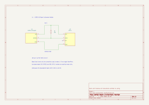
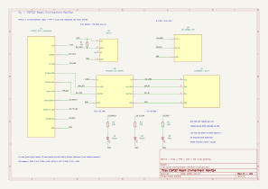
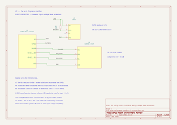
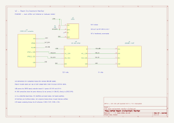
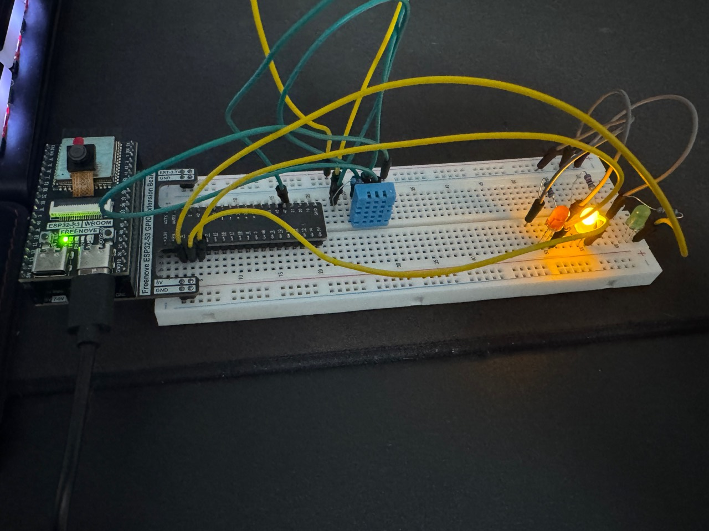
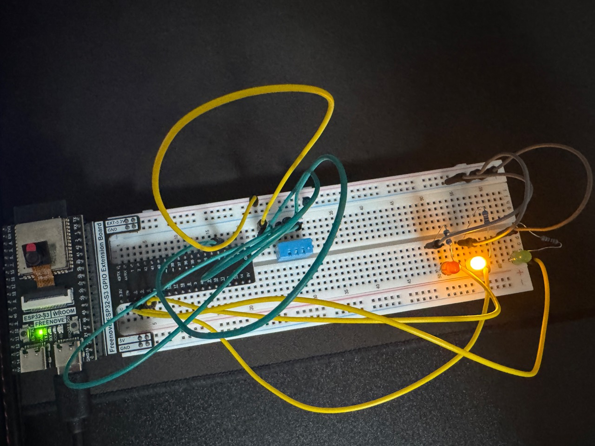
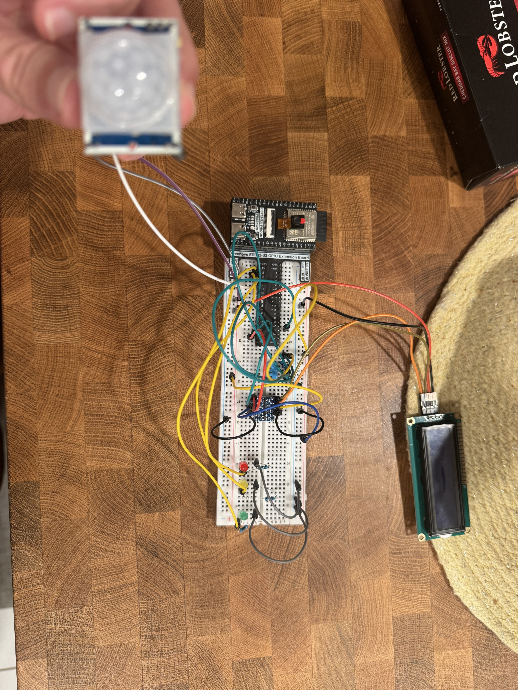
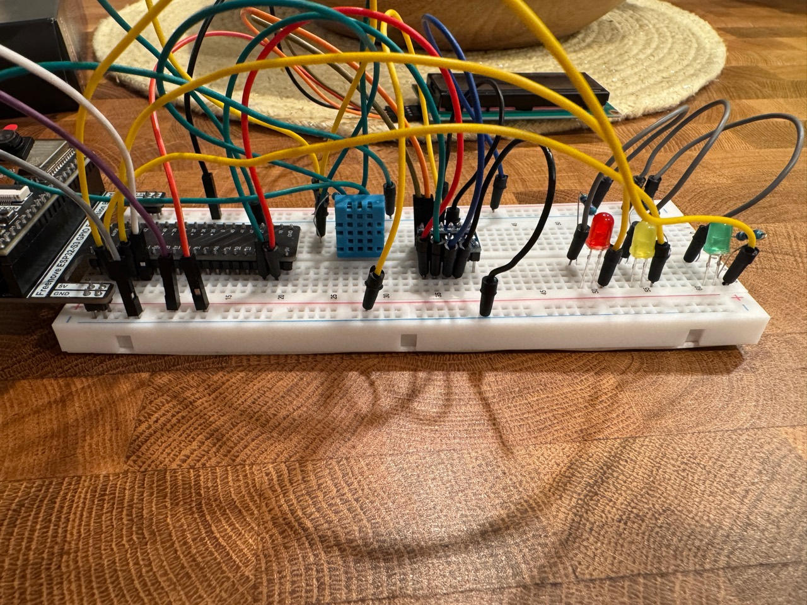
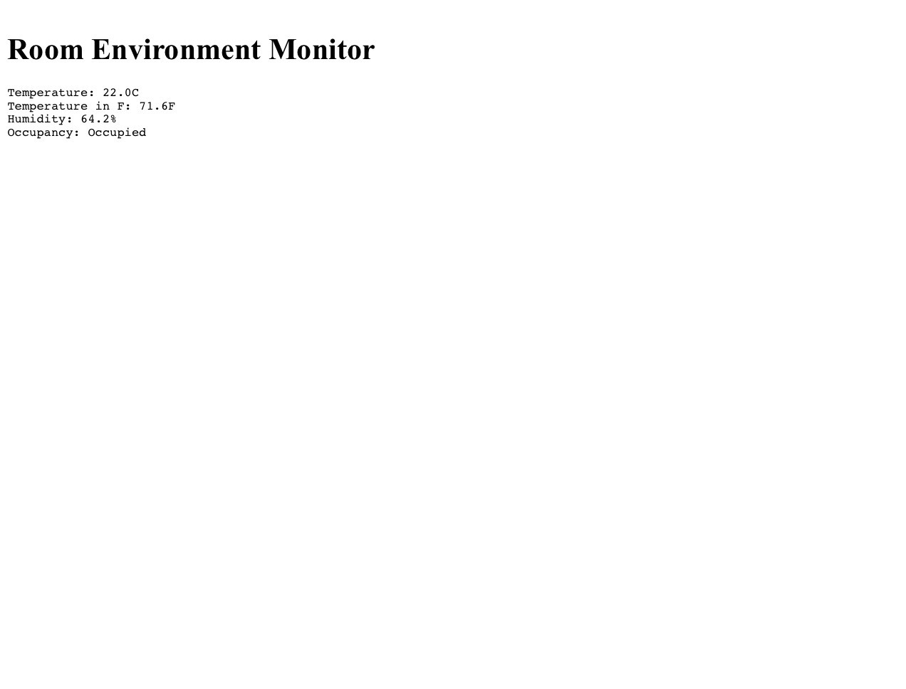

# ESP32 Room Environment Monitor

I'm building this project as part of my embedded-systems portfolio for Computer Engineering. I started with the Freenove ESP32-S3 kit tutorials and am developing the monitor one version at a time to practice sensor interfacing, debugging, timing, and code organization.

**Current milestone: V5 browser dashboard — October 14, 2026.** I can now view temperature, humidity, and motion status from my phone. The page refreshes every five seconds and shows a message if the sensor reading fails. The LCD, LEDs, and Serial output still work alongside it. I connected through my router's 2.4 GHz guest network; reconnecting after a reset is still inconsistent, as described in the [V5 notes](#v5-wi-fi-and-browser-dashboard).

## V1: temperature and humidity over Serial

For V1, I connected a DHT11 sensor and printed temperature in Celsius, temperature in Fahrenheit, and relative humidity to Serial Monitor. I calculate Fahrenheit in the sketch using `(C * 1.8) + 32`.

I use `millis()` to schedule measurement attempts every 2,000 ms. If a reading fails, the program prints the library's error message and waits until the next scheduled attempt before trying again.

I separated the measurement work into `readEnvironment()`. The main `loop()` decides when to call it, while the function reads the sensor, checks its status, calculates Fahrenheit, and prints the results.

## Hardware and wiring

For V1, I used:

- Freenove ESP32-S3 development board and GPIO extension board
- DHT11 temperature/humidity sensor
- 10 kΩ pull-up resistor
- Breadboard, jumper wires, and USB cable

| DHT11 connection | My wiring |
| --- | --- |
| Pin 1: VCC | Board 3.3 V |
| Pin 2: DATA | ESP32-S3 GPIO 21 |
| Pin 3: NC | Unconnected |
| Pin 4: GND | Breadboard ground rail connected to board GND |
| 10 kΩ resistor | Between DATA/GPIO 21 and 3.3 V |

The pull-up resistor holds the data line high when it is idle. Although the tutorial diagram labels the sensor data pin SDA, the DHT11 uses its own digital protocol, not I2C. I don't use an ADC input for this sensor.

Power off before changing wiring, and use the kit's sensor pin diagram to identify the physical pins.

## V1 schematic



[Editable KiCad project](HardWare/room-environment-monitor/room-environment-monitor.kicad_pro) | [PDF schematic](HardWare/room-environment-monitor/room-environment-monitor.pdf)

## Current wiring: V4 schematic



[Editable KiCad project](HardWare/room-environment-monitor-v4/room-environment-monitor-v4.kicad_pro) | [PNG diagram](HardWare/room-environment-monitor-v4/room-environment-monitor-v4.png)

This diagram includes the current GPIO assignments, one 220 ohm resistor per LED, the DHT11 pull-up, the HC-SR501, and the installed LCD voltage interface. V5 adds Wi-Fi and the dashboard without changing the wiring, so this is still the current schematic. I use the module labels to identify connections; the ESP32 board block is a simplified symbol rather than a drawing of the physical headers.

## Software and setup

To run the project:

1. Open `Second_Project.ino` in Arduino IDE. Keep the sketch inside the `Second_Project` folder.
2. Install ESP32 board support, DHTesp, and the kit's LiquidCrystal I2C library. `WiFi` and `WebServer` are included with the ESP32 board package. The LCD communicates through the installed bidirectional level shifter.
3. Copy `secrets.example.h` to `secrets.h` in the sketch folder. Replace the placeholders in `secrets.h` with the name and password of a 2.4 GHz Wi-Fi network. I keep this file local; `.gitignore` excludes it from Git.
4. Select the board configuration and USB port used for the ESP32-S3 kit tutorials.
5. Upload the sketch and open Serial Monitor at **115200 baud**.
6. Check for the startup message, followed by measurements approximately every two seconds. Once Wi-Fi connects, Serial prints `Ip Address:` followed by the assigned address.
7. Connect a phone or computer to the same network and open `http://<printed-IP>/` in a browser, replacing `<printed-IP>` with the actual address. Use HTTP. The page refreshes every five seconds. Guest-network isolation settings can affect whether devices can reach each other; browser access worked on my tested guest network.
8. Allow 60 seconds for PIR warm-up. The backlight stays on and the page says `PIR warming up` during startup. After warm-up, motion and occupancy messages print when their states change, and the backlight follows the occupancy estimate.

Example Serial output:

```text
 Temperature:25.00°C Temperature Fahrenheit:77.00°F Humidity:50.00%
```

This is an example of the output format, not a saved measurement. The installed versions recorded for this milestone are ESP32 board package **3.3.12**, DHTesp **1.19**, and LiquidCrystal I2C **1.1.2**. I still need to record the exact board-menu configuration. The LiquidCrystal I2C library's AVR architecture warning appeared during compilation, but I successfully uploaded and tested the LCD code on my ESP32-S3.

The current sketch runs the DHT11, LCD1602, Serial output, environmental LEDs, PIR motion/occupancy logic, and browser dashboard. I call `readMotion()`, `updateLcdBacklight()`, `checkWifiStatus()`, and `server.handleClient()` on each loop pass, while `readEnvironment()` stays scheduled every two seconds. The V4 schematic above shows the combined wiring; the earlier schematics remain available as project history.

## V1 testing

I uploaded and tested V1 on my board:

| Test | Result |
| --- | --- |
| Normal sensor readings | Working |
| Celsius, Fahrenheit, and humidity output | Working |
| Refactor into readEnvironment() | Uploaded and working |
| millis() scheduling | Uploaded and working |
| Disconnected DHT11 data wire | Serial printed timeout on the refactored version |

I tested the behavior directly on the hardware. I haven't done sensor accuracy calibration, precise timing measurements, automated build checks, or long-duration testing. I haven't recorded a separate V1 reconnect/recovery test.

To repeat the failure test, power off, disconnect DATA, restart, and check for an error. Power off again before reconnecting DATA, then restart and check that readings return.

## Design decisions and limitations

- I use `millis()` instead of a two-second `delay()` so the program can do other work between measurement attempts.
- I update the attempt timestamp before reading, so failed attempts also respect the interval.
- I use unsigned elapsed-time subtraction to handle millis() rollover.
- I read the sensor inside `readEnvironment()` and save the latest successful measurements in globals for the browser. Opening the page doesn't trigger another sensor read.
- I check the sensor status before converting or printing measurements.
- The sensor transaction still takes time; scheduling with millis() doesn't make the library call asynchronous.
- Printing decimal places doesn't establish the sensor's accuracy or precision.
- I don't store a history of measurements. Failed reads print an error instead of measurements, select the red LED, and replace the LCD readings with an error message. The page hides the saved measurements when `environmentValid` is false, while motion status stays available. The LCD backlight still follows occupancy; sensor errors do not force it on.
- The browser makes a new HTTP request every five seconds. That refresh interval is separate from the two-second sensor interval. Sensor reads, Serial output, I2C operations, and handling a web request can still take time.

## V2: LCD development and voltage investigation

I added an I2C LCD1602 while keeping the Serial output. I tested Celsius and Fahrenheit on the first row, humidity on the second, and the messages "Sensor error" and "Check Wiring" when the DHT11 reading fails. My error handler clears both rows before printing its messages. I still need to add padding to normal measurement updates so shorter values fully replace previous text.

I used address **0x27**, SDA on **GPIO 14**, and SCL on **GPIO 13**. Following the Freenove tutorial, I initially powered the LCD from the extension board's USB-supplied **5 V** and connected it to the board's GND.

### V2 schematic: previously tested direct wiring



[Editable V2 direct-wiring KiCad project](HardWare/room-environment-monitor-v2-current/room-environment-monitor-v2-current.kicad_pro) | [PNG diagram](HardWare/room-environment-monitor-v2-current/room-environment-monitor-v2-current.png)

This diagram records the direct 5 V LCD connection I used during functional testing, without a level shifter. I measured the disconnected LCD signal pins near 5 V afterward, so I am documenting this circuit with its unresolved voltage issue rather than treating it as electrically validated. The separate V2 design below shows the level-shifting approach; the current combined V4 schematic is linked above.

### Earlier V2 level-shifter design



[Editable V2 KiCad project](HardWare/room-environment-monitor-v2/room-environment-monitor-v2.kicad_pro) | [PNG diagram](HardWare/room-environment-monitor-v2/room-environment-monitor-v2.png)

I created this diagram while planning the LCD voltage-interface correction. I have since installed the shifter and added the LEDs and PIR. This earlier sheet does not include those additions; the current V4 schematic above documents the combined build.

### Voltage measurements

With the LCD powered at 5 V and its SDA/SCL wires disconnected from the ESP32, I measured approximately **4.9-5.0 V** on those signals relative to GND. I then tried powering the LCD from 3.3 V. The signals measured approximately **3.3 V**, but the display did not show text.

I'm still learning to use the multimeter, so measurement error is possible. I haven't independently verified the readings or checked the meter's accuracy. However, the voltage change followed the module's supply voltage, which is consistent with pull-up resistors connected to that supply. I can't assume the readings are harmless or dismiss them as an error without further testing.

The [ESP32-S3 datasheet, Table 5-4](https://documentation.espressif.com/esp32-s3_datasheet_en.pdf) specifies a high-level input maximum of VDD + 0.3 V, approximately **3.6 V** with a 3.3 V GPIO supply. My measured 5 V signals exceed that specification. Seeing the display work doesn't confirm that the direct connection is electrically compatible.

### Installed LCD interface — October 11, 2026

I installed one module from the [DIYables five-pack of presoldered four-channel bidirectional I2C level shifters](https://diyables.io/products/5-pack-4-channel-iic-i2c-level-converter-module-bi-directional-logic-level-shifter-5v-to-3.3v-for-arduino-raspberry-pi-esp8266-esp32-sensors-presoldered-compact-adapter-board). It translates SDA and SCL between the ESP32's 3.3 V side and the LCD's 5 V side. The LCD still takes power directly from the extension board's USB-supplied 5 V; the shifter does not generate its power.

| Connection | My wiring |
| --- | --- |
| Shifter LV | Board 3.3 V |
| Shifter HV | Board 5 V |
| Shifter GND connections | Board GND |
| LV1 | GPIO 14 / SDA |
| HV1 | LCD SDA |
| LV2 | GPIO 13 / SCL |
| HV2 | LCD SCL |
| LCD VCC | Board 5 V, shared with shifter HV |
| LCD GND | Board GND, shared with all modules |

Channels 3 and 4 are unused. I disconnected USB while changing wiring. Before connecting LV1/LV2 to the ESP32 GPIOs, I powered the shifter and LCD with LCD communication disabled and checked DC voltages relative to common GND:

| Signal | Approximate idle measurement |
| --- | --- |
| LV1 | 3.3 V |
| LV2 | 3.3 V |
| HV1 | 5 V |
| HV2 | 5 V |

I then restored the GPIO connections, LCD initialization, normal measurement display, and sensor-error display calls. The LCD worked alongside Serial output, environmental LEDs, and PIR reporting. With DHT11 DATA disconnected and the board restarted, the LCD showed "Sensor error" / "Check Wiring", the red LED was on, and Serial reported the sensor error. PIR reporting still worked after warm-up. After reconnecting DATA and restarting, normal readings and the appropriate environmental LED returned.

These were manual functional tests and idle DC measurements. I haven't recorded I2C waveforms, independently calibrated the meter, or tested long-duration bus operation. The recovery test used a restart; it does not establish recovery without restarting. I performed these combined sensor-error and recovery tests before adding the backlight control described in V4 below.

The current temperature-row layout is intended for readings below **100 °F**. Higher readings need a shorter layout to fit within the LCD's 16 columns.

## V3: environmental LED status indicators

For this milestone, I added green, yellow, and red LEDs while keeping the DHT11 readings and Serial output. Each LED has its own 220 ohm series resistor. I tested the LEDs individually before connecting their behavior to the sensor readings.

### LED wiring

| LED | ESP32-S3 GPIO | Connection |
| --- | --- | --- |
| Green | 4 | GPIO 4 -> 220 ohm resistor -> anode; cathode -> GND |
| Yellow | 5 | GPIO 5 -> 220 ohm resistor -> anode; cathode -> GND |
| Red | 6 | GPIO 6 -> 220 ohm resistor -> anode; cathode -> GND |

The LEDs and DHT11 share the board's GND. My DHT11 wiring remains the same as V1. I removed the LCD during the original V3 tests; it is now restored in the combined V4 build.

### Status logic

I set the temperature limits to **20-26 degrees Celsius** and the humidity limits to **30-60% relative humidity**. Both endpoints count as within range. These are adjustable project thresholds, not a calibrated assessment of room conditions.

| Sensor result | Green | Yellow | Red |
| --- | --- | --- | --- |
| Valid reading; both measurements within range | ON | OFF | OFF |
| Valid reading; either measurement outside range | OFF | ON | OFF |
| Failed reading | OFF | OFF | ON |

All three LEDs start off until the first measurement attempt. I check the sensor status before comparing measurements, so a failed read selects red instead of being treated as an environmental warning.

I moved the repeated LED writes into `ledControl(bool greenOn, bool yellowOn, bool redOn)`. Its parameters are ordered green, yellow, red. Each status call sets all three outputs, so an LED from the previous status doesn't stay on. `readEnvironment()` still handles the sensor check and range decisions, while `loop()` schedules measurement attempts with `millis()`.

### Hardware testing

I uploaded the sketch and tested these behaviors on my ESP32-S3:

| Test | Result |
| --- | --- |
| Green, yellow, and red LEDs tested individually | Each LED worked; Serial readings continued |
| Within-range reading | Green only |
| Reading outside either configured range | Yellow only |
| Disconnected DHT11 DATA | Red only, with the sensor error in Serial |
| DATA reconnected and board restarted | Normal readings and the appropriate valid-reading indicator returned |
| Refactor into ledControl() | Uploaded and repeated the green, yellow, and red tests successfully |

During testing, a reading of **22.9 degrees Celsius and 64% humidity** selected yellow because humidity exceeded 60%. I temporarily raised `maxHumidity` to 70 to test green, then restored it to 60. Changing the limit let me test the decision without replacing the sensor's measurements with made-up values.

These are manual functional tests. I haven't tested every exact threshold boundary, millis() rollover on hardware, sensor accuracy, or long-duration operation. There is no hysteresis yet, so readings that cross a threshold repeatedly can switch between green and yellow. Reconnecting DATA with a restart verifies recovery after restart; it doesn't establish recovery without restarting.

### Build photos



My ESP32-S3, DHT11, and three status LEDs during V3 testing. The yellow status LED is lit; I had removed the LCD while its level-shifter integration was pending.



A second view of the physical breadboard build. The photos document the assembly; the wiring tables record the GPIO assignments and resistor values.

The LED milestone is complete. I later restored the LCD through the level shifter and tested it with the LEDs and PIR, as recorded in the October 11 integration above.

## V4: PIR motion and occupancy estimate

I added the kit's HC-SR501 PIR motion sensor while keeping the DHT11, Serial output, and environmental LEDs working. I first developed this version with the LCD removed, then restored the display through the level shifter and added occupancy-controlled backlight behavior.

### PIR wiring

| HC-SR501 connection | My wiring |
| --- | --- |
| VCC / + | Extension board's USB-supplied 5 V |
| OUT / S | ESP32-S3 GPIO 7 |
| GND / - | Board GND, shared with the DHT11 and LEDs |

I identify the module pins from their labels and the kit diagram, rather than assuming a left-to-right order. The module uses 5 V power and provides an approximately 3.3 V HIGH output, as described in [Freenove's HC-SR501 documentation](https://docs.freenove.com/projects/fnk0082/en/latest/fnk0082/codes/Python/25_Infrared_Motion_Sensor.html). I read OUT with `digitalRead()`; the PIR needs no additional library or ADC conversion.

### Timing and state logic

| Setting | Current value | Purpose |
| --- | --- | --- |
| `readInterval` | 2,000 ms | Schedule DHT11 measurement attempts |
| `pirWarmupInterval` | 60,000 ms | Suppress PIR and occupancy reporting during startup |
| `occupancyTimeout` | 15,000 ms | Keep the occupancy estimate true after the last sampled HIGH |

I set `pirStartTime` in `setup()`. During warm-up, `readMotion()` returns immediately, so temperature, humidity, and LED updates continue without a 60-second `delay()`.

I call `readMotion()` on each pass through `loop()`, outside the two-second DHT timing condition. Motion polling is independent of that interval, although a sensor transaction or Serial output can still take time. This is polling, not interrupt-based event capture.

`previousMotionState` starts at -1 so the first PIR reading after warm-up prints once. Later, I print `PIR: 0` or `PIR: 1` only when the level changes.

When the PIR is HIGH, I set `occupied` to true and refresh `lastMotionTime` on every HIGH reading. When it is LOW, I keep the previous occupancy estimate until 15 seconds have elapsed since the last sampled HIGH. New HIGH readings refresh the timer. I capture the old occupancy value before updating it, then print an occupancy message only if the value changed.

An illustrative sequence of motion messages is:

```text
PIR: 1
Occupancy: Occupied
PIR: 0
Occupancy: No Recent Movement
```

The last line appears after the software timeout; it is not printed immediately with `PIR: 0`. Temperature and humidity messages continue between these events. This example shows the format, not a captured Serial log. If the first PIR reading is LOW, only `PIR: 0` prints initially because `occupied` already starts false.

### Hardware testing

I uploaded and tested the motion and occupancy behavior on my ESP32-S3:

| Test | Result |
| --- | --- |
| PIR motion and return to LOW | Both 1 and 0 observed |
| `readMotion()` refactor and motion-change reporting | Working; PIR messages print on level changes |
| 60-second warm-up | Environmental readings and LEDs continue; PIR reporting begins after warm-up |
| HIGH after warm-up | Occupancy becomes true and prints once |
| LOW before the software timeout | Occupancy stays true |
| LOW through the 15-second software timeout | Occupancy clears and prints once |
| HIGH returns before the timeout expires | Timer refreshes and occupancy stays true |

During the earlier raw-input test, I estimated that the PIR took about 40-60 seconds to return LOW after activity. I did not time that precisely. The module's own hold time and my software timeout are separate: the software keeps occupancy true for about 15 seconds after the output goes LOW. I haven't recorded the potentiometer positions or H/L jumper setting yet.

### Occupancy-controlled LCD backlight

I added `updateLcdBacklight()` and call it immediately after `readMotion()`. The backlight starts on and stays on during the 60-second PIR warm-up. After warm-up, it follows `occupied`: recent activity turns it on, and the occupancy timeout turns it off. If the first PIR reading after warm-up is LOW and no activity has been recorded, it turns off at that point.

I track the commanded backlight state in `lcdBacklightOn` and send `lcd.backlight()` or `lcd.noBacklight()` only when the desired state changes. Turning off the backlight leaves the LCD powered. Measurement display updates, Serial output, environmental LEDs, and motion polling continue.

I uploaded this version and tested:

| Test | Result |
| --- | --- |
| Startup warm-up | Backlight stays on |
| LOW after warm-up with no recorded activity | Backlight turns off |
| PIR HIGH / occupied | Backlight turns on |
| PIR returns LOW | Backlight remains on during the occupancy grace period |
| LOW continues through the occupancy timeout | Backlight turns off |
| Backlight off | Serial readings and environmental LEDs continue working |

The backlight follows occupancy even during a DHT11 error. Error text is still written to the LCD, but the code does not force illumination on; Serial and the red LED remain the other error indicators. I haven't separately repeated the sensor-error/recovery test with the new backlight feature.

### Current build photos



My combined V4 assembly with the PIR held above the breadboard and the LCD connected alongside it. The breadboard includes the DHT11, level shifter, and three environmental status LEDs.



A closer view of my DHT11, installed level shifter, and LED wiring. These photos document the physical assembly; they do not show active LCD readings. My functional test results are recorded in the tables above.

### Limitations and next steps

This is an occupancy estimate based on recent PIR activity. A stationary person may stop triggering the sensor, so I use the message "No Recent Movement" instead of claiming that the room is empty. A LOW reading also doesn't distinguish no activity from a disconnected or failed PIR signal.

These are manual functional tests. I haven't measured response latency, checked long-duration operation or millis() rollover on hardware, or calibrated detection coverage. PIR reporting is suppressed during warm-up, so startup should not be interpreted as a confirmed empty-room state.

The combined V4 motion/occupancy, LCD, and backlight milestone is complete. The updated KiCad diagram above includes the PIR, LEDs, and installed level shifter. The current build photos are included above, and the earlier V3 photos remain labeled as V3.

## V5: Wi-Fi and browser dashboard

I started by connecting the ESP32 to Wi-Fi and printing its IP address in Serial Monitor. I then added a simple web response and opened it on my phone. Once that worked, I added the readings, sensor-error handling, motion status, an HTML heading, and automatic refresh.



My V5 dashboard displaying 22.0 C, 71.6 F, 64.2% humidity, and an occupied status. This image records the page during testing; the values come from the saved sensor readings and motion state.

The page currently shows:

- Temperature in Celsius and Fahrenheit
- Relative humidity
- `Sensor Reading Unavailable` if the DHT reading fails or no successful reading has happened yet
- `PIR warming up`, `Occupancy: Occupied`, or `Occupancy: No recent Movement`

The ESP32 serves the page at `/` on port 80. I build the response in `handleRoot()` and send it once with `server.send()`. The page uses a five-second HTML refresh setting, so I don't need to reload it manually.

### Saved readings and separate state

I keep the latest successful measurements in `latestTemperatureC`, `latestTemperatureF`, and `latestHumidity`. `environmentValid` starts false, becomes true after a successful read, and goes false after a failed read. The saved numbers remain in memory after a failure, but the page shows the error message instead of presenting them as current readings.

The browser uses these saved values. `readEnvironment()` still controls when the DHT is read, so opening or refreshing the page doesn't request another measurement. I add motion status separately from the environmental `if/else`, so a DHT error doesn't hide occupancy information. During PIR warm-up, I show the warm-up message instead of treating the initial false occupancy value as no recent movement.

### What I tested

I uploaded each addition and checked it on my ESP32-S3 and phone:

| Test | Result |
| --- | --- |
| Connect to the 2.4 GHz guest network | Connected and received an IP address |
| Open the printed HTTP address on my phone | Displayed `Room Monitor Online` in the first test |
| Add the saved Celsius, Fahrenheit, and humidity readings | Displayed the measurements |
| Failed DHT reading | Page displayed the unavailable message |
| Add PIR warm-up and occupancy reporting | Page displayed motion status separately from the measurements |
| Convert the response to HTML | Heading and measurement lines displayed correctly |
| Add the five-second refresh setting | Page refreshed without manually reloading |

These were manual functional tests. I haven't measured request latency, tested multiple browsers at once, or run a long-duration test. The dashboard works, but reliable reconnection is still unfinished.

### Wi-Fi issue I still need to fix

I tested with a NETGEAR Nighthawk RAX50. Attempts on my main network reported reason `201` (`NO_AP_FOUND`). Separating the 2.4 GHz network from Smart Connect didn't resolve it. Using the 2.4 GHz guest network did let the ESP32 connect, and I could access the page from my phone.

Some resets or USB disconnect/reconnect attempts still fail. Serial has shown `Association refused too many times, max allowed 1`, reason `208` (`ASSOC_COMEBACK_TIME_TOO_LONG`), and reason `36` (`STA_LEAVING`). I haven't confirmed the cause. The [Espressif reason-code documentation](https://docs.espressif.com/projects/esp-idf/en/stable/esp32s3/api-guides/wifi-driver/station-scenarios.html) describes reason 208 as an association response with a comeback time that is too long.

I kept the disconnect callback to print the reason codes. My application starts Wi-Fi once in `setup()` and reports connection changes in `checkWifiStatus()`. I haven't added my own timed reconnect logic yet. That is the next reliability improvement; I am recording this milestone as a working dashboard with an unresolved connection issue.

### Next improvements

For one final software pass, I want to work on the connection failures after resetting or reconnecting USB. I plan to add a reconnect timer using `millis()` and test repeated starts and recovery while the rest of the monitor keeps running. A timer may help the monitor recover, but I still need to investigate why the router sometimes refuses the connection.

After that, I want to record a short video showing the physical build and dashboard working together. I may also try a PCB design to get some layout experience, but that is optional and I haven't started it. The current KiCad files document the wiring; they are not a finished PCB design.

Other possible improvements are a phone-friendly page layout and padding normal LCD updates so shorter readings clear the previous text.

## Version progression

- **V1:** DHT11 to Serial Monitor — completed and hardware tested as described above
- **V2:** LCD1602 output — restored through the level shifter; idle voltages and combined functional tests recorded above
- **V3:** Environmental LED status indicators — completed and hardware tested; working with the restored LCD
- **V4:** PIR motion/occupancy estimate and LCD backlight control — completed and hardware tested as described above
- **V5:** Wi-Fi and a browser dashboard — basic dashboard tested on my phone; reset/reconnect reliability remains unresolved

V5 uses the V4 wiring and build photos above. The dashboard is working; the next software step is improving reconnection behavior.

## References and attribution

I used the **Freenove ESP32-S3 Ultimate Starter Kit tutorial** as the starting point for the sensor code and wiring. The tutorial schematic was a reference; I haven't redistributed it in this repository.

My changes include calculating Fahrenheit, replacing the goto retry loop with error reporting, using millis() scheduling, separating the work into functions, adding LCD measurements and error messages, selecting LED status indicators from sensor validity and configurable thresholds, adding PIR state-change reporting with a non-blocking warm-up and occupancy timeout, installing I2C level shifting, controlling the LCD backlight from the occupancy estimate, and serving saved readings and motion status in a browser.

Libraries:

- [DHTesp](https://github.com/beegee-tokyo/DHTesp)
- [LiquidCrystal I2C](https://github.com/marcoschwartz/LiquidCrystal_I2C)
- [Arduino-ESP32](https://github.com/espressif/arduino-esp32) — board support, WiFi, and WebServer
